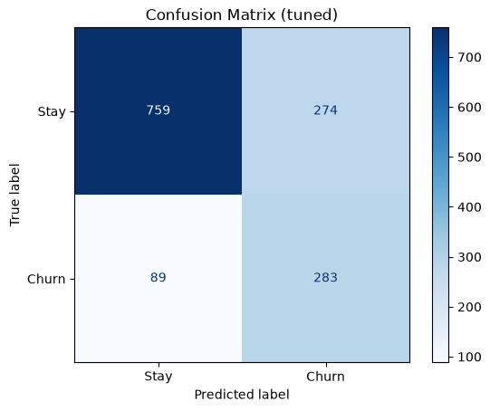
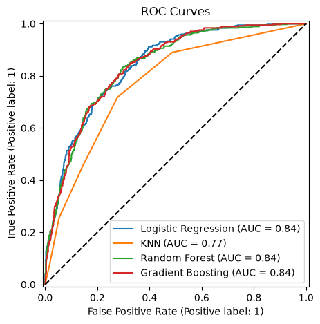
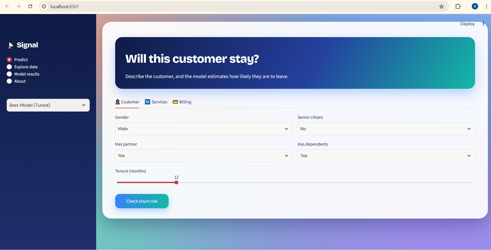
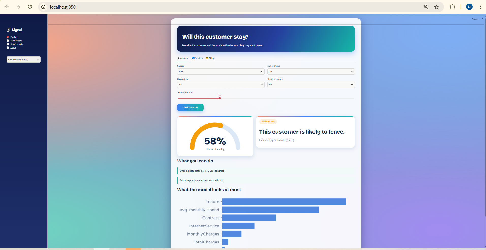
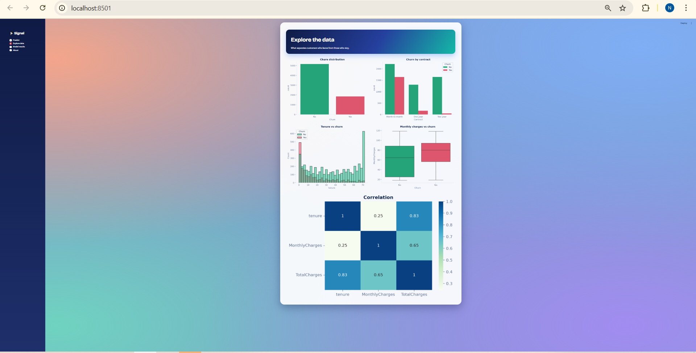
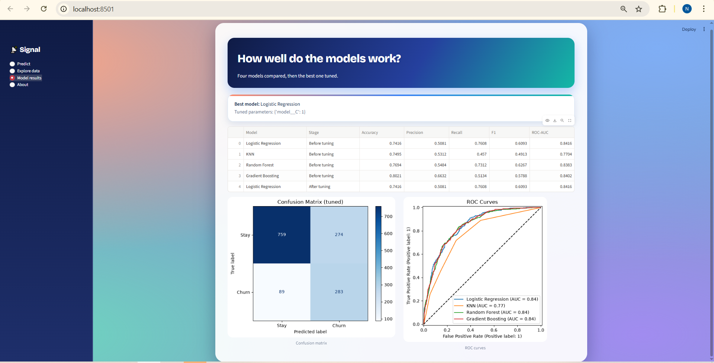

# 📡 Customer Churn Prediction System

An end-to-end machine learning application that predicts whether a telecom customer is likely to leave (churn). The user enters customer details in a Streamlit interface and receives a churn probability, a risk level, retention suggestions and the model's most important factors.

🔗 **Live app:** [Open the app](https://churn-app-fsxywxzatfjovhyytwnlow.streamlit.app/)
💻 **Source code:** [github.com/shanaya3016/churn-app](https://github.com/shanaya3016/churn-app)

## Features
- Interactive prediction page with a churn probability gauge and risk level (Low / Medium / High)
- Retention suggestions based on the customer's details
- Feature importance chart
- Data visualization page
- Model performance page (results table, confusion matrix, ROC curves)
- Choice between four trained models and the tuned best model

## Dataset
[IBM Telco Customer Churn](https://www.kaggle.com/datasets/blastchar/telco-customer-churn) (Kaggle). Each row is a customer, with services, billing information and whether the customer churned.

## Workflow
1. **Data processing:** blank `TotalCharges` values converted to missing values and imputed, duplicates removed, outliers detected with the IQR method and capped, categorical features one-hot encoded, numerical features scaled.
2. **Feature engineering:** `tenure_group`, `avg_monthly_spend` and `num_services`.
3. **Model development:** four models trained and compared (Logistic Regression, KNN, Random Forest, Gradient Boosting) on a stratified 80/20 split.
4. **Hyperparameter tuning:** `GridSearchCV` (5-fold, scored on ROC-AUC) applied to the best model.
5. **Model saving:** final model saved with Joblib.
6. **Deployment:** Streamlit app deployed on Streamlit Community Cloud.

## Results

| Model | Stage | Accuracy | Precision | Recall | F1 | ROC-AUC |
|---|---|---|---|---|---|---|
| Logistic Regression | Before tuning | 0.7416 | 0.5081 | 0.7608 | 0.6093 | **0.8416** |
| KNN | Before tuning | 0.7495 | 0.5313 | 0.4570 | 0.4913 | 0.7704 |
| Random Forest | Before tuning | 0.7694 | 0.5484 | 0.7312 | 0.6267 | 0.8383 |
| Gradient Boosting | Before tuning | 0.8021 | 0.6632 | 0.5134 | 0.5788 | 0.8402 |
| Logistic Regression | After tuning | 0.7416 | 0.5081 | 0.7608 | 0.6093 | 0.8416 |

**Best model: Logistic Regression.** It has the highest ROC-AUC and a recall of 76%, which matters here because the goal is to catch customers who are about to leave. Gradient Boosting has the highest accuracy, but it misses many churners (recall 51%).

**Tuning:** `GridSearchCV` selected `C = 1`, which is the model's default value, so the metrics did not change. This confirms the default parameters were already optimal for this data.

### Confusion matrix and ROC curves



## Screenshots





## Project structure
```
churn-app/
├── app.py                  # Streamlit application
├── train.py                # Training, tuning and saving
├── utils.py                # Shared cleaning and feature engineering
├── requirements.txt
├── .streamlit/config.toml  # App theme
├── data/                   # Telco-Customer-Churn.csv
├── models/                 # Saved models, results, feature importance
└── assets/                 # Plots and screenshots
```

## Run locally
```bash
pip install -r requirements.txt
python train.py
streamlit run app.py
```

## Tech stack
Python, Pandas, NumPy, Scikit-learn, Matplotlib, Seaborn, Streamlit, Joblib, Git & GitHub.